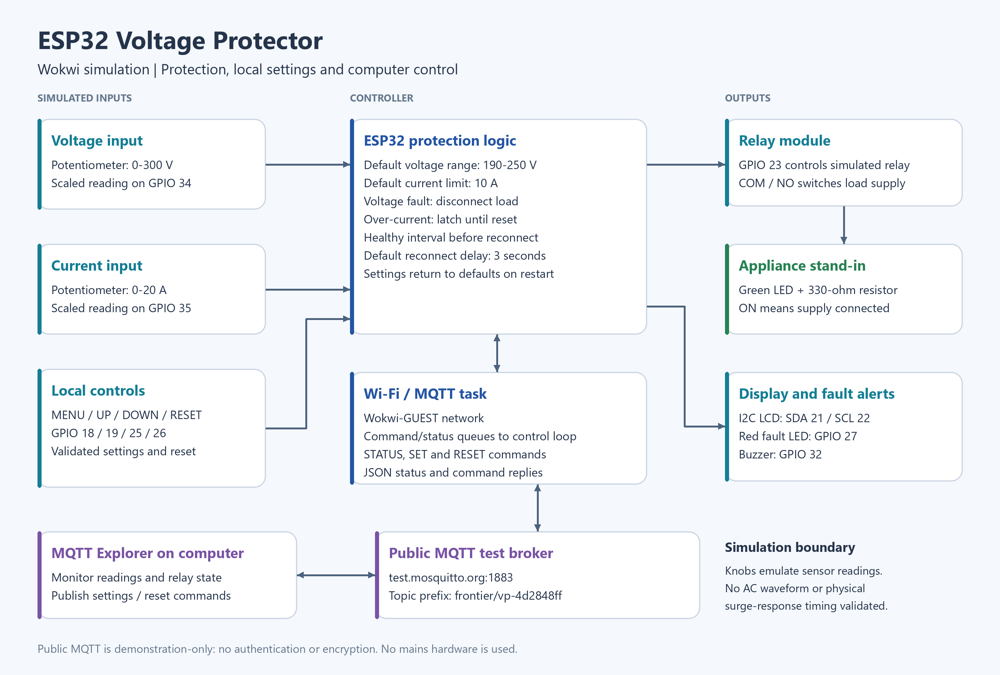
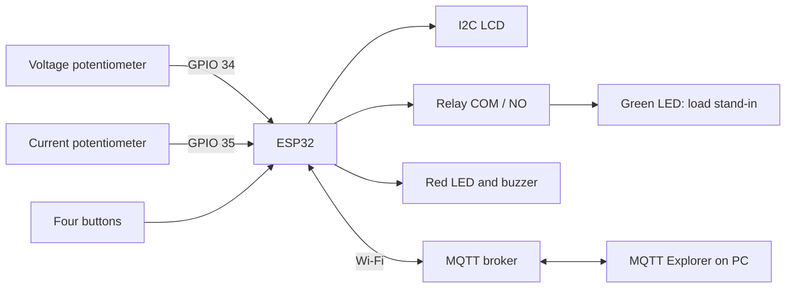

# Wokwi block diagram

[Main README](../readme.md) · [Setup and controls](../project_files/readme.md) · [Test evidence](../test_evidence/readme.md)

## How the blocks work

Two potentiometers supply independent simulated voltage and current measurements. The ESP32 compares readings with configured limits and controls the relay. The green LED is powered through relay contacts and represents the appliance supply. The LCD displays readings or a selected setting. The red LED and buzzer signal faults. Buttons and MQTT commands can change controller settings.

## Wiring

See [diagram.json](../project_files/diagram.json) for full connections and [sketch.ino](../src/sketch.ino) for implementation.

| Signal | GPIO |
|---|---:|
| Voltage / current inputs | 34 / 35 |
| LCD SDA / SCL | 21 / 22 |
| Relay control | 23 |
| MENU / UP / DOWN / RESET | 18 / 19 / 25 / 26 |
| Fault LED / buzzer | 27 / 32 |

Potentiometers use 3.3 V and ground; the simulated LCD/relay use 5 V and ground. Buttons connect their GPIO to ground when pressed and use internal pull-ups. The load path is 5 V → relay COM → relay NO → 330-ohm resistor → green LED → ground. NC is unused. The I2C LCD uses address 0x27. Relay ON=HIGH in the verified Wokwi setup.

## Protection states

| LCD state | Meaning | Recovery |
|---|---|---|
| LOW VOLTAGE | Below minimum | Restore safe readings and wait |
| HIGH VOLTAGE | Above maximum | Restore safe readings and wait |
| CURRENT LATCH | Current exceeded limit now or earlier | Restore safe readings and request RESET |
| RECONNECT WAIT | Healthy interval in progress | Wait without another fault or settings change |
| LOAD ON | Supply connected to load | Fault or valid settings change disconnects it |

Current latching takes display priority over voltage faults. RESET requires both readings to be safe. Settings changes do not clear the current latch.

## Firmware tasks

The Arduino loop owns measurements, settings, protection state, relay, buttons and LCD. It targets 20 ms sensor checks, 30 ms button debounce, 250 ms display updates, and one-second telemetry. The LCD writes only changed characters. A separate FreeRTOS task handles broker connections and MQTT; queues transfer copied commands/status. These intervals are scheduling targets, not measured worst-case timing guarantees.

This is a simulation diagram, not a mains construction schematic. A physical implementation would require isolated sensing and appropriate protection hardware. See [limitations in the main README](../readme.md#protection-and-limitations).
